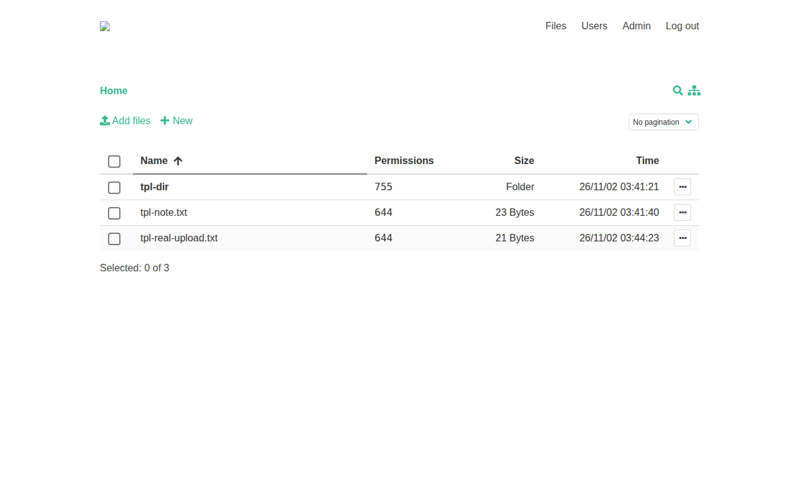

# FileGator

FileGator is a powerful multi-user file manager for the web — upload, download, preview, edit, zip, and share files from any browser, with admins and users who each get their own home folder and permissions. Deploy it on Railway and your files live on your own persistent volume, not a third-party cloud.

*File manager UI captured from a test deployment (test data only).*

## Source Repository

[https://github.com/INAPP-Mobile/filegator](https://github.com/INAPP-Mobile/filegator)

## Deploy and Host

One-click deploy creates a single FileGator service with a persistent volume. No database is needed: FileGator stores its users in a JSON file and your files in a repository folder, both on the volume. On first boot the wrapper maps Railway's injected `PORT` onto Apache, wires the volume under both data directories, and sets the admin password from the generated deploy variable (exactly once — later password changes in the UI are never reset by a redeploy).

After deploy, open the public URL and sign in as `admin` with the generated `ADMIN_PASSWORD` (find it in your Railway project's variables). Change it in the UI if you ever rotate it — changing the variable after first boot does not change the password.

## Why Deploy

- Multi-user file management with roles and permissions: admins and users with separate home folders.
- All basic file operations: copy, move, rename, edit, create, delete, preview, zip, unzip, download, upload.
- Chunked uploads with drag & drop, progress bar, pause and resume — large files upload regardless of server limits.
- No database to manage: users and files both live on the persistent volume.
- Self-hosted data: your files stay on your Railway volume.

## Common Use Cases

- Share a folder with colleagues, a team, friends, or family.
- Let students or field workers upload their work, docs, or images.
- Use it as cloud backup or an FTP/SFTP replacement.
- Manage a CDN or shared assets with multiple people.
- Zip and download remote files in bulk.

## Configuration

Only one variable appears on the deploy form, and it is generated:

| Variable | Default | Description |
| --- | --- | --- |
| `ADMIN_PASSWORD` | `${{secret(16)}}` | Password for the `admin` account, set exactly once on first boot. Generated on deploy; keep it stable, or change the password in the FileGator UI (changing this variable after first boot does not change the password). |

Everything else is baked into the image. Applicable upstream variables and their baked values:

| Variable | Value | Description |
| --- | --- | --- |
| `PORT` | Railway-injected | Apache listen port: upstream's configs literally contain `${APACHE_PORT}` (Apache expands it from the environment), so the wrapper exports it as Railway's `PORT` on every boot. |
| `APACHE_DOCUMENT_ROOT` | `/var/www/filegator/dist/` | Upstream default; the Vue frontend bundle. |
| `timezone` | `UTC` | Upstream default from `configuration.php`. |
| `upload_max_size` | `100 MB` | Upstream default frontend cap (chunked 1 MB uploads). |
| `download_inline` | `['pdf']` | Upstream default; PDFs preview inline in the browser. |
| `lockout_attempts` / `lockout_timeout` | `5` / `15s` | Upstream defaults; failed logins from one IP lock out briefly. |
| `csrf_key` | random per boot | Upstream ships the public default `123456`; the wrapper replaces it with a fresh random value on every boot. |
| `session save path` | `private/sessions` (on volume) | Upstream default is the system temp dir; the wrapper points it at the volume so logins survive restarts. |
| `auth adapter` | JSON file | Upstream default (`private/users.json`); no database required. |
| `storage adapter` | local `repository/` | Upstream default; files live on the volume. S3/FTP/Dropbox adapters are upstream options not wired in this template. |

## Persistence

A single volume is mounted at `/data` and holds both upstream data directories via symlinks: `repository/` (your files) and `private/` (`users.json`, logs, sessions, tmp). Restarts and redeploys keep users and files; deleting the volume resets to the first-boot state.

## Details

- Runtime: PHP 8.3 + Apache serving the Vue frontend, single service, no database.
- Memory at rest: a single small PHP/Apache service.
- Port: listens on Railway's injected `PORT` (rewritten from upstream's baked 8080 by the wrapper entrypoint).
- Upstream: [filegator/filegator](https://github.com/filegator/filegator) v7.16.8, MIT, image pinned by digest.
- Healthcheck: `GET /` (the SPA shell, no auth required).
- Default accounts: `admin` (password from `ADMIN_PASSWORD`) and `guest` (no permissions, upstream default).
- Upstream quirk: the "New file" action reports `Failed` but the file is created (refresh the listing to see it); creating files via the editor save and uploads report correctly.

### Deployment Dependencies

- Plan tier: works on Railway's entry tiers; a single always-on service with a 5 GB volume.
- RAM needs: modest — one PHP/Apache service, no companion database or cache service.
