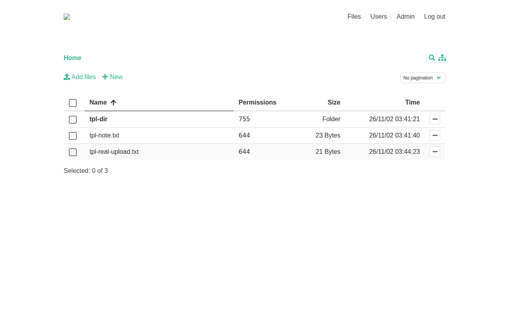

*File manager UI captured from a test deployment (test data only).*

# Deploy and Host

FileGator is a powerful multi-user file manager for the web — upload, download, preview, edit, zip, and share files from any browser, with admins and users who each get their own home folder and permissions. One-click deploy creates a single service with a persistent volume and no database: users live in a JSON file and files in a repository folder, both on the volume. After deploy, sign in as `admin` with the generated password from your project's variables.

## About Hosting

Hosting FileGator on Railway keeps your files on your own volume instead of a third-party cloud. The deployment is a single always-on PHP/Apache service: the wrapper maps Railway's injected `PORT` onto Apache, wires the volume under both data directories, sets the admin password from a generated variable exactly once, and replaces upstream's public-default CSRF key with a fresh random value on every boot. The only deploy-form field is the generated admin password.

## Why Deploy

- Multi-user file management with roles and permissions: admins and users with separate home folders.
- All basic file operations: copy, move, rename, edit, create, delete, preview, zip, unzip, download, upload.
- Chunked uploads with drag & drop, progress bar, pause and resume — large files upload regardless of server limits.
- No database to manage: users and files both live on the persistent volume.
- Self-hosted data: your files stay on your Railway volume.

## Common Use Cases

- Share a folder with colleagues, a team, friends, or family.
- Let students or field workers upload their work, docs, or images.
- Use it as cloud backup or an FTP/SFTP replacement.
- Manage a CDN or shared assets with multiple people.
- Zip and download remote files in bulk.

## Dependencies for

- A single FileGator service (PHP 8.3 + Apache, Vue frontend, no database).
- One persistent volume mounted at `/data` (repository files + private users, logs, sessions).
- Environment variables (condensed reference — full documentation in the repo README):

| Variable | Default | Description |
| --- | --- | --- |
| `ADMIN_PASSWORD` | generated | Password for the `admin` account, set exactly once on first boot; the only deploy-form field. |
| `PORT` | Railway-injected | Apache listen port, rewritten from upstream's baked 8080 by the wrapper entrypoint. |
| `upload_max_size` | `100 MB` | Upstream default frontend cap (chunked 1 MB uploads). |
| `csrf_key` | random per boot | Upstream ships the public default `123456`; the wrapper replaces it on every boot. |
| `session save path` | `private/sessions` (on volume) | Upstream default is the system temp dir; the wrapper points it at the volume. |

### Deployment Dependencies

- Plan tier: works on Railway's entry tiers; a single always-on service with a 5 GB volume.
- RAM needs: modest — one PHP/Apache service, no companion database or cache service.
